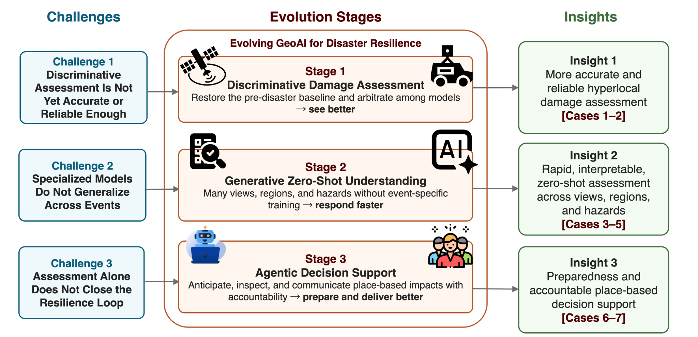

# Dissertation Proposal

This folder records my dissertation proposal: the final proposal document and the defense slides as presented to my committee, plus the defense flyer.

**Proposal defense:** Thursday, October 22, 2026, 1:00–2:30 p.m. CDT, Room 807, Eller O&M Building ([flyer](./2026-10-22-proposal-defense-flyer.pdf)); not passed, second defense planned for November 2026 ([see below](#the-first-defense-and-the-second))
**Program:** Ph.D., Geography, Texas A&M University
**Committee:** Dr. Lei Zou (Chair), Dr. Heng Cai, Dr. Andrew Klein, Dr. Zhengzhong Tu

## Dissertation

**Advancing GeoAI for Disaster Resilience: From Damage Assessment to Responsible Decision Support**

> "Seeing, describing, and governing disasters: beyond the boundaries of the screen, let the real world become the stage for intelligence."

Disaster resilience is a geographical question: it is rooted in space, diverse across the globe, a spatial inquiry into where, how severely, and who, and a cycle in time from preparedness to response, recovery, and mitigation. Damage assessment is the hinge of that cycle, and imagery from overhead and ground-level views is its primary evidence. The dissertation advances GeoAI along three evolving model families, each answering one challenge:

| Challenge | Stage | Insight | Cases |
| --- | --- | --- | --- |
| Discriminative assessment is not yet accurate or reliable enough | **Stage 1, discriminative damage assessment:** restore the pre-disaster baseline and arbitrate among models, to *see better* | More accurate and reliable hyperlocal damage assessment | 1–2 |
| Specialized models do not generalize across events | **Stage 2, generative zero-shot understanding:** many views, regions, and hazards without event-specific training, to *respond faster* | Rapid, interpretable, zero-shot assessment across views, regions, and hazards | 3–5 |
| Assessment alone does not close the resilience loop | **Stage 3, agentic decision support:** anticipate, inspect, and communicate place-based impacts with accountability, to *prepare and deliver better* | Preparedness and accountable place-based decision support, delivered by RAY (Resilience Assistant for You) | 6–7 |

Cases 1–5 are complete (CEUS 2025; Natural Hazards under review; ACM SIGSPATIAL 2026; IEEE IGARSS 2026; CRC Press chapter under review). Cases 6 and 7 are in progress, with the final defense and graduation planned for Summer 2027.

## Final versions

| Date | Document | File |
| --- | --- | --- |
| 2026-10-22 | Dissertation proposal, final version submitted to the committee | [PDF](./2026-10-22-yifan-yang-dissertation-proposal.pdf) |
| 2026-10-22 | Proposal defense slides (40 slides + 3 backup slides) | [PDF](./2026-10-22-yifan-yang-proposal-defense-slides.pdf) |
| 2026-10-22 | Proposal defense flyer | [PDF](./2026-10-22-proposal-defense-flyer.pdf) |

Earlier working drafts (2026-09-30 proposal drafts, 2026-10-12 slide draft) were removed from this folder once the final versions were fixed; they remain in the git history.

## The first defense, and the second

The first proposal defense on October 22, 2026 did not pass. I am keeping that on record here rather than leaving only the polished final versions, because the failure is part of the journey and probably the most instructive part of it. The proposal will be defended again before the same committee in **November 2026**.

That evening I wrote about it on my WeChat official account: **[Moving Toward Greater Failures! (向着更大的失败前进！)](https://mp.weixin.qq.com/s/hdapQiYII-huy9pmjt59wg)**. The essay starts from Cao Cao after the Battle of Red Cliffs, who answered defeat with "victory and defeat are common in war" (胜败乃兵家常事) and went on to regroup. Reflection does not undo a failure, but it restores morale and the nerve to go back into the field, and to aim at larger challenges, and so at larger possible failures, next time.

| Date | Event | Record |
| --- | --- | --- |
| 2026-10-22 | First proposal defense, not passed | Final versions above; [reflection essay](https://mp.weixin.qq.com/s/hdapQiYII-huy9pmjt59wg) |
| 2026-11 (planned) | Second proposal defense | To be added |

## After the second defense

- Committee feedback from the first defense and the revisions it led to
- Revised proposal and slides for the second defense, if they differ from the versions above
- Reflections: what changed between the preliminary examination, the first defense, and the second, and why
